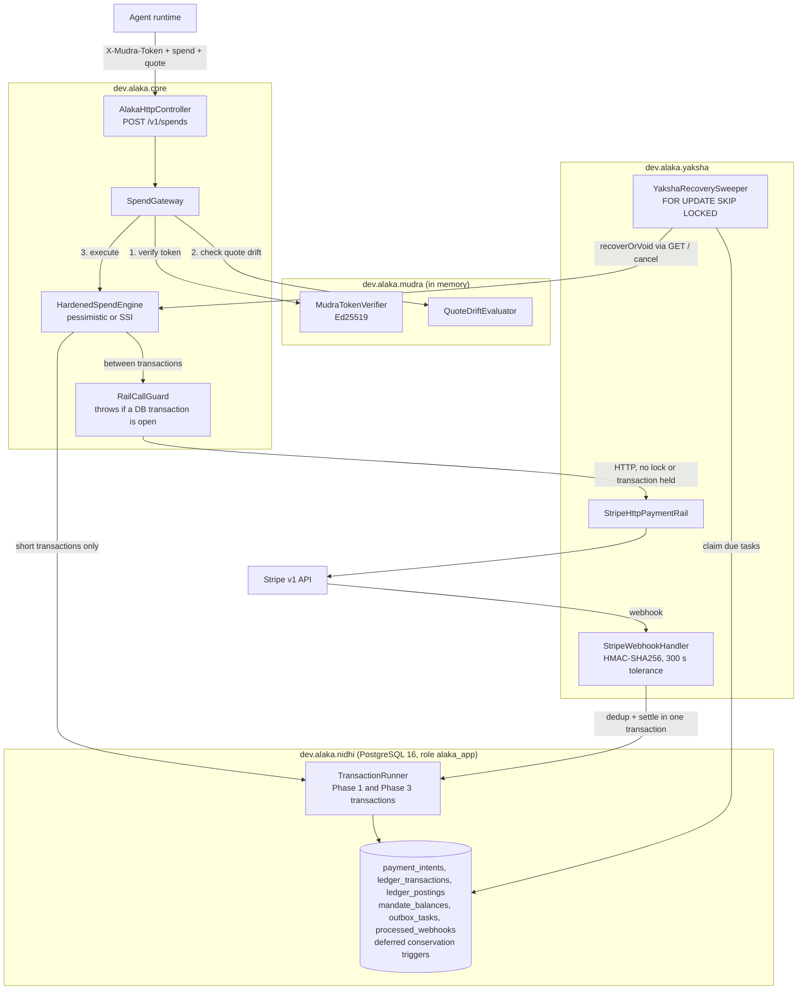
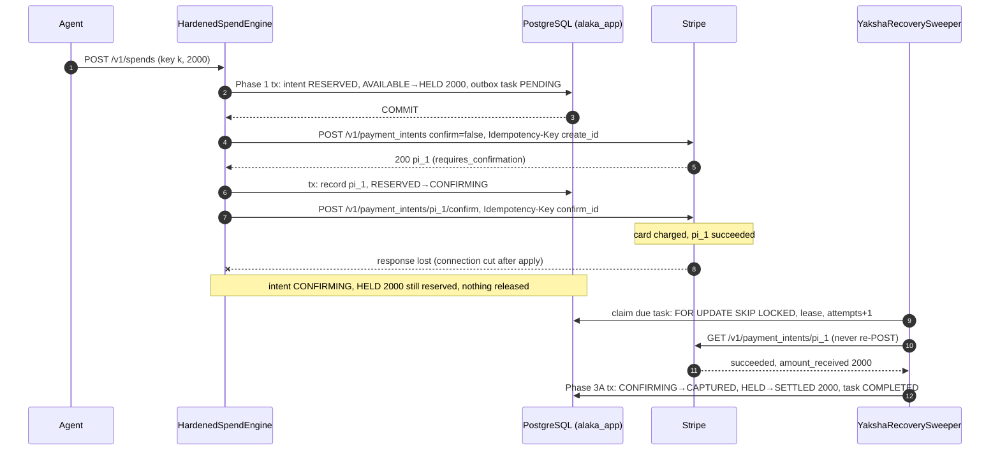
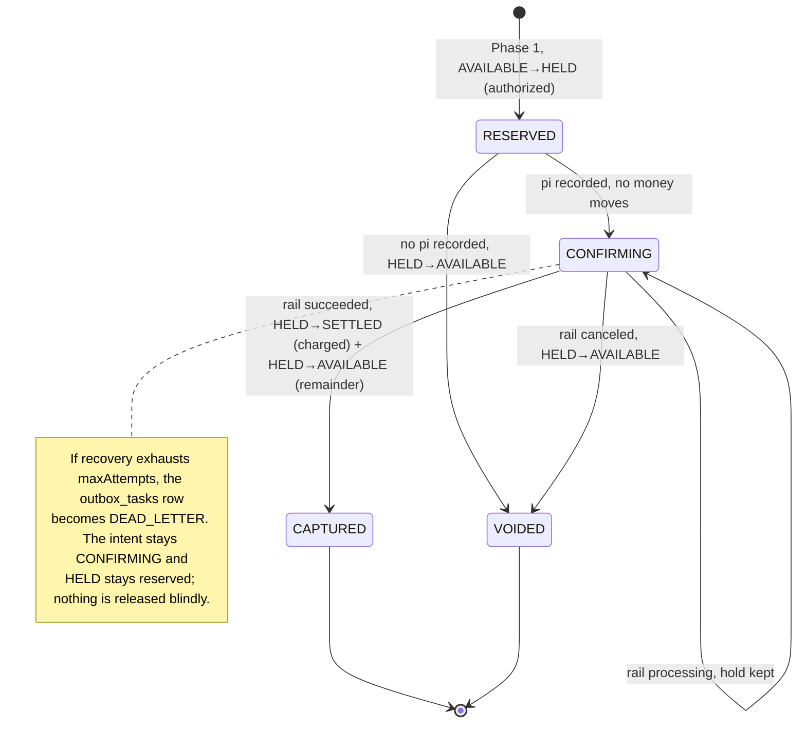

# Alaka

Alaka is a spend-authorization and settlement kernel that sits between an autonomous agent and a
payment rail. Given a signed spending mandate, it guarantees three things. They hold under
concurrent requests, client retries, lost HTTP responses, process crashes and injected network
faults:

- **I1 — no overspend.** A mandate is never overspent, neither in the ledger nor on the rail.
- **I2 — at most one charge.** Each `(agent_id, idempotency_key)` is charged at most once.
- **I6 — no silent drift.** The ledger and the rail never disagree silently: a `VOIDED` intent has
  no succeeded charge, and a `CAPTURED` intent settled exactly what the rail charged.

The repository contains the protocol's TLA+ specification, a PostgreSQL 16 ledger kernel that
enforces the invariants at `COMMIT`, a Java 21 execution engine with three concurrency modes, a
Stripe v1 wire adapter, and the test suites that try to break each layer. One command re-runs all of
it: `bash scripts/verify-all.sh`.

The rest of this file explains, in order:

1. what fails in the obvious design;
2. what replaces it;
3. how each layer is verified;
4. what is not covered.

[`docs/DESIGN.md`](docs/DESIGN.md) is the long-form reference.

---

## 1. The problem

An agent that can move money issues payments from untrusted reasoning: prompt injection,
hallucinated loops, parallel tool calls and aggressive retries. A per-request cap in the agent
runtime does not bound what reaches the payment rail. Three failure mechanisms explain why.

### 1a. Quote-to-settlement drift

A user approves a purchase at a quoted price. Between that approval and the moment money moves, the
amount can rise, or the merchant or currency can change. The cause may be a malicious HTTP 402
challenge, a repricing, or a confused agent. A static cap such as "at most $50 per request" accepts
every drifted amount below the cap.

What has to be checked is the relationship between the settlement and the approved quote: same
merchant, same currency, amount within an explicit slippage tolerance, and an unexpired quote.

### 1b. Read-then-charge races (TOCTOU)

The obvious implementation has three steps:

1. read `SUM(spent)`;
2. check `spent + amount <= budget` in application code;
3. call the rail and record the spend.

Every concurrent request that finishes step 1 before any request reaches step 3 sees the same
`spent` and passes. Under `READ COMMITTED` nothing prevents this; parallel tool calls and retry
storms make it routine.

This repository implements that design as `--mode=naive` (`NaiveSpendEngine`, unguarded table
`naive_spend_log`) to measure it. Fifty concurrent requests against a 10,000 budget charged the rail
**34,996–39,995** across seven runs (§6.3).

### 1c. Lost responses and an unindexed remote side effect

The simplest Stripe integration is one `POST /v1/payment_intents` with `confirm=true`. If that
response is lost, because of a timeout, a connection cut or a crash, the client cannot tell whether
the card was charged. The ways it could find out each fail, per Stripe's API reference:

- **List.** `GET /v1/payment_intents` cannot filter by idempotency key.
- **Search.** The Search API is eventually consistent (data becomes searchable within about a
  minute). It is unsuitable for read-after-write recovery, and it is unavailable to India-based
  accounts.
- **Re-sending the POST.** Stripe saves the result of an idempotent request once the endpoint has
  started executing, including a 500, so re-sending the same key replays the 500. Keys also expire
  after 24 hours.
- **Cancelling.** `POST /v1/payment_intents/{id}/cancel` succeeds only in `requires_*` states. A
  card payment that is `processing` or `succeeded` answers
  `400 payment_intent_unexpected_state`.

A recovery job that voids the local reservation because "the charge does not seem to exist" can
therefore release budget while a delayed confirm is still in flight. The confirm then succeeds, and
the freed budget is spent a second time. This exact interleaving is the TLC counterexample in §5.

---

## 2. Design

### 2.1 Four trust boundaries

The packages are named after the treasury city of Kubera (*Alakā*); each name marks a trust
boundary.

| Package | Name | Trusts | Responsibility |
|---------|------|--------|----------------|
| `dev.alaka.mudra` | *Mudrā*, the seal | Only trusted Ed25519 public keys | Verifies capability tokens; rejects quote drift. Runs entirely in memory, before any database access |
| `dev.alaka.nidhi` | *Nidhi*, the treasury | Nothing; it enforces | PostgreSQL 16 double-entry ledger. Every invariant that can be stated over rows is enforced by the database itself, against the runtime role `alaka_app` |
| `dev.alaka.yaksha` | *Yakṣa*, the guardians | Stripe's `GET` and webhooks with valid HMAC signatures | Two-step rail adapter, webhook verification and deduplication, crash recovery sweeper |
| `dev.alaka.core` | | Its collaborators | Orders the phases, gates idempotency, selects the concurrency mode, serves HTTP |



Zero locks are held across HTTP calls, and this is enforced, not just documented:

- Database work happens only inside `TransactionRunner.inTransaction` lambdas, and they receive a
  connection and nothing else.
- Every rail call passes through `RailCallGuard`, which throws `IllegalStateException` if a
  transaction is open on the calling thread.

### 2.2 The protocol: three local phases, two rail steps

| Step | Where | What |
|------|-------|------|
| Phase 1 | One DB transaction | Idempotency gate (§4.3). Lock the mandate `FOR SHARE`; in the pessimistic mode also lock `mandate_balances FOR UPDATE`. Insert the intent as `RESERVED`, a `RESERVE` ledger transaction (`DEBIT MANDATE_AVAILABLE`, `CREDIT MANDATE_HELD`) and a recovery task in `outbox_tasks`, then `COMMIT` |
| Step 2A | HTTP | `POST /v1/payment_intents` with `confirm=false` and `Idempotency-Key: create_<intent_id>`. An unconfirmed payment intent cannot move money, so a delayed or duplicated create is harmless |
| | One short DB transaction | Record `pi_...` (write-once) and move `RESERVED` to `CONFIRMING` |
| Step 2B | HTTP | `POST /v1/payment_intents/{pi}/confirm` with `Idempotency-Key: confirm_<intent_id>`. This is the only call that can move money, and it is sent only after `CONFIRMING` with the `pi_...` has been committed |
| Phase 3A | One DB transaction | `CONFIRMING` to `CAPTURED`, with a `CAPTURE` ledger transaction: `DEBIT HELD` (authorized), `CREDIT SETTLED` (charged) and, for a partial capture, `CREDIT AVAILABLE` (the remainder). The task is marked `COMPLETED` |
| Phase 3B | Recovery | Decided only from the rail's own answer to `GET /v1/payment_intents/{pi}`. `succeeded`: capture. `canceled`: void. `requires_*`: `/cancel` first, and void only on 200; on 400, re-read. `processing`: change nothing and keep the hold. An intent still `RESERVED` with no `pi_...` recorded is voided, because no confirm was ever sent |

The sequence below is the failure from §1c: the confirm is applied by Stripe, but the response
never arrives. `ToxiproxyChaosTest` reproduces it over a real TCP proxy (§7).



### 2.3 Intent lifecycle and bucket movements

Every arrow that moves money is one database transaction, in which the intent row, the ledger
transaction and its balanced postings commit together (enforced: `[NIDHI-D9]`, §6.2). The schema's
`intent_status` also defines `AUTHORIZED` and `FAILED`, which the engine does not use.



### 2.4 Concurrency modes

| Mode | Isolation | Control | Retries |
|------|-----------|---------|---------|
| `naive` | `READ COMMITTED`, autocommit | None. App-level check-then-act; records the spend after the rail call | None |
| `hardened-pessimistic` | `READ COMMITTED` | `spend_mandates FOR SHARE`, then `mandate_balances FOR UPDATE`, then `payment_intents FOR UPDATE`, always in that order | Up to 5 attempts on `40001` / `40P01`; in practice only deadlocks occur |
| `hardened-ssi` | `SERIALIZABLE` | No explicit balance lock (taking it would make this the pessimistic mode) | Whole-transaction retry on `40001` / `40P01`. At most 100 attempts, with exponential backoff and full jitter (1 ms base, 64 ms cap) |

---

## 3. Invariants and where each one is enforced

`spec/AlakaInFlight.tla` and the Java `InvariantChecker` use the same names.

| Invariant | Enforced by | Checked by |
|-----------|-------------|-----------|
| **I1** no overspend: `held + settled <= budget`; rail total `<= budget`; per-transaction cap | Deferred trigger `trg_verify_tx_and_mandate_integrity` (`SG003`); intent insert trigger (`SG003`); the protocol for the rail total | TLC invariant `I1_NoMandateOverspent`; SQL suite; property suite; storm; chaos |
| **I2** at most one intent and one charge per key; 422 on payload mismatch; 409 while in flight | `UNIQUE (agent_id, idempotency_key)`; SHA-256 `request_hash`; rail keys `create_<id>` / `confirm_<id>` | TLC action property `I2_OneReservationAndOneChargePerKey`; engine tests; property suite; storm |
| **I3** balanced transactions; three-bucket routing; `available + held + settled = budget`, each `>= 0` | Deferred triggers (`SG005`); composite foreign keys (`23503`) | TLC `I3_LedgerConservation` and `LedgerMatchesIntents`; SQL suite; property suite |
| **I4** no new spend on a revoked or expired mandate; terminal mandate states are irreversible | Intent insert trigger (`SG001`) using PostgreSQL `NOW()`; mandate state-machine trigger (`SG004`) | TLC action property `I4_RevokedMandateReservesNothing` (revocation only); SQL suite; property suite |
| **I5** monotonic intent lifecycle; terminal states never change | Intent state-machine trigger (`SG004`); write-once fields (`SG006`) | TLC action property `I5_MonotonicStateMachine`; SQL suite; property suite |
| **I6** no `VOIDED` intent with a succeeded charge; `CAPTURED` equals the rail's charge | Phase 3B: never void unless the rail said `canceled` or no `pi` was ever recorded | TLC `I6_NoSilentRailDrift` and `ExactCaptureConsistency`; property suite; storm; chaos |

---

## 4. Pillar 1: the formal specification (TLA+)

### 4.1 What is modelled

`spec/AlakaInFlight.tla` interleaves the actions of two idempotency keys (three in the wide
configuration) over a shared mandate. Its variables are:

- the mandate status;
- the three balance buckets;
- each intent's state and amount;
- the confirm packet: `NONE`, `IN_FLIGHT` or `DELIVERED`. A packet that stays in flight is a delayed
  or lost response;
- the rail's view of each payment intent: `CREATED`, `PROCESSING`, `SUCCEEDED` or `CANCELED`;
- the amount the rail actually charged;
- the last `/cancel` response, `OK` or `REJECTED`.

The rail is modelled with these behaviours:

- **Rejected cancels.** `/cancel` is its own step, and the rail rejects it while the payment intent
  is `PROCESSING` or `SUCCEEDED`.
- **Delayed resolution.** `PROCESSING` resolves later, nondeterministically, to `SUCCEEDED` or
  `CANCELED`.
- **Partial capture.** A charge may be lower than the authorized amount, and the remainder returns
  to `MANDATE_AVAILABLE`.

The recovery actions are enabled at every interleaving, so "the worker never saw the response" is
covered without modelling worker processes explicitly.

Two constants enable the two known bugs:

- `AllowBlindVoidWithoutCancel`: void locally while a confirm packet may still be in flight;
- `AllowVoidOnCancelFailure`: void although `/cancel` was rejected because the payment intent was
  `PROCESSING`.

### 4.2 Results

The safe configuration (`spec/AlakaInFlight.cfg`) checks:

- invariants: `TypeOK`, `I1_NoMandateOverspent`, `ExactCaptureConsistency`, `I3_LedgerConservation`,
  `LedgerMatchesIntents`, `I6_NoSilentRailDrift`, `ProcessingKeepsHeldLocked`,
  `VoidedOnlyAfterRailCanceled`, `RailWorstCaseExposureWithinBudget`, `OpenIntentCanAlwaysProgress`;
- action properties: `I5_MonotonicStateMachine`, `RailMonotonic`,
  `I2_OneReservationAndOneChargePerKey`, `I4_RevokedMandateReservesNothing`.

The tool is TLC 2.19 (`tools/tla2tools.jar`, v1.7.4). The unsafe configurations run with
`-workers 1`, which yields the shortest counterexample deterministically.

| Config | Bounds | Result | States generated | Distinct | Trace / depth |
|--------|--------|--------|-----------------:|---------:|---------------|
| `AlakaInFlight.cfg` | 2 keys; amounts {4, 6, 7}; budget 10; per-tx cap 6; partial charges {2, 4} | No error | 25,052 | **6,642** | depth 16 |
| `AlakaInFlightWide.cfg` | 3 keys; amounts {3, 4, 6, 7}; otherwise the same | No error | 4,411,811 | **940,994** | depth 23 |
| `AlakaInFlightUnsafeBlindVoid.cfg` | blind void enabled | `I6_NoSilentRailDrift` violated | 482 | 268 | 6-state trace |
| `AlakaInFlightUnsafeBlindVoidNoI6.cfg` | same, I6 not checked | `I1_NoMandateOverspent` violated | 12,298 | 4,275 | 10-state trace |
| `AlakaInFlightUnsafeCancelFailure.cfg` | void on rejected cancel | `I6_NoSilentRailDrift` violated | 2,313 | 986 | 8-state trace |
| `AlakaInFlightUnsafeCancelFailureNoI6.cfg` | same, I6 not checked | `I1_NoMandateOverspent` violated | 19,837 | 6,011 | 12-state trace |

The four unsafe configurations show the order in which each bug does damage:

1. **Silent drift first.** The ledger and the rail disagree as soon as the buggy void happens and
   the delayed payment lands: `I6` fires at trace length 6 (blind void) or 8 (void after a rejected
   cancel).
2. **Overspend second.** The overspend needs more steps, because the freed budget must be reserved
   and charged again. With `I6` unchecked, TLC finds `I1` at length 10 or 12. The rail charges
   6 + 6 = 12 against a budget of 10.

So `I6` is the earlier alarm: it detects the bug one full reservation before money is lost. The
cancel-failure trace, as TLC prints it:

```
Init → ReserveSpend(k1) → CreateUnconfirmedPI(k1) → SendConfirmPacket(k1)
     → RailReceiveConfirmPacket(k1)   [rail: PROCESSING]
     → RailHandleCancelRequest(k1)    [cancel REJECTED]
     → BuggyVoidOnCancelFailure(k1)   [hold released]
     → RailResolveProcessing(k1)      [rail: SUCCEEDED]   ⇒ I6 violated
```

`scripts/verify-all.sh` requires the safe configurations to pass and every unsafe configuration to
be rejected with exactly its expected invariant. An unsafe configuration that passes fails the run,
because it would mean the checker had lost its teeth.

### 4.3 Ruling out vacuity

A safety proof is worthless if the interesting states are unreachable. Two checks address that.

**Reachability probes.** `spec/probes/` holds 14 configurations. Each one asserts the negation of a
behaviour that should occur, and TLC produces a witness for all 14. The witnessed behaviours
include:

- a `PROCESSING` payment intent, and a cancel rejected while it is processing;
- a partial capture that releases the remainder;
- a void after the rail cancels, and a void with a confirm packet still in flight;
- two intents open at once;
- a capture after revocation;
- a `CONFIRMING`-to-`VOIDED` step.

**Mutation checks.** Seven mutants of the specification are each caught when checked against the
safe configuration:

| Mutation | Caught by |
|----------|-----------|
| Reserve ignores revocation | `I4_RevokedMandateReservesNothing` |
| Partial capture drops the remainder | `I3_LedgerConservation` |
| Remainder left in HELD | `LedgerMatchesIntents` |
| Capture settles the authorized amount instead of the charged amount | `ExactCaptureConsistency` |
| No per-transaction cap | `I1_NoMandateOverspent` |
| `PROCESSING` never resolves | `OpenIntentCanAlwaysProgress` |
| No terminating stutter | TLC deadlock check |

The `PROCESSING`-never-resolves mutant is the reason `OpenIntentCanAlwaysProgress` exists. TLC's
deadlock check alone did not catch it, because a `CONFIRMING` intent can always re-send `/cancel`.

The mutants are not in this repository. They were re-checked against the current `AlakaInFlight.cfg`
while this document was written.

---

## 5. Pillar 2: the PostgreSQL 16 ledger kernel (nidhi)

### 5.1 Shape

**Accounts and balances.**

- Each mandate has exactly three accounts: `MANDATE_AVAILABLE`, `MANDATE_HELD`, `MANDATE_SETTLED`.
- `mandate_balances` is a materialised view of `ledger_postings`. Its only sanctioned writer is the
  `AFTER INSERT` posting trigger, `trg_apply_posting_to_mandate_balance`.

**Bucket routing.** Each `transition_type` fixes which buckets a ledger transaction may touch:

- `RESERVE`: AVAILABLE → HELD;
- `VOID`: HELD → AVAILABLE;
- `CAPTURE`: HELD → SETTLED, plus HELD → AVAILABLE for the uncaptured remainder.

**No cross-mandate or cross-currency postings.** The composite foreign keys
`(tx_id, mandate_id, currency)` and `(account_id, mandate_id, currency)` make such postings
unrepresentable (`23503`).

### 5.2 Why conservation is a deferred trigger, not a `CHECK`

A `RESERVE` inserts its two postings one row at a time. After the first (`DEBIT AVAILABLE`), the
materialised balance sums to `budget - amount`. An immediate
`CHECK (available + held + settled = total)` would therefore reject every valid transaction at its
first row.

`trg_verify_tx_and_mandate_integrity` instead runs as a `DEFERRABLE INITIALLY DEFERRED` constraint
trigger at `COMMIT`, attached `AFTER INSERT` on both `ledger_transactions` and `ledger_postings`.
Attaching it to postings as well means a lone posting appended later to an already-committed
transaction is re-verified and rejected. At `COMMIT` the trigger verifies:

- the transaction balances (debits equal credits, at least two postings);
- the routing matches its `transition_type`;
- every bucket is `>= 0`, and the three sum to `total`;
- the materialised balance equals the raw `SUM` of postings.

Overdraw is caught by the `>= 0` check, so it surfaces as `SG003` at `COMMIT`.

The immediate `CHECK`s that do exist cover only what holds on every single row: positive posting
amounts, positive authorized amounts, captured amount within the authorized amount, and the pairing
of `captured_amount_minor` with `status = 'CAPTURED'`.

### 5.3 Roles

| Role | Can | Cannot |
|------|-----|--------|
| `alaka_migrator` | Own every object; apply migrations 001 onwards | Create databases or roles |
| `alaka_app` (runtime) | `SELECT` and `INSERT` on the ledger tables; `UPDATE` on intents, mandates and outbox; `UPDATE (version)` on `mandate_balances` (needed only for `SELECT ... FOR UPDATE`) | `TRUNCATE`, `DELETE`, `ALTER`, `DROP`; disable triggers; `SET session_replication_role`; create tables, temp tables or functions; `SET ROLE`; write any balance column |

The two trigger functions that write tables `alaka_app` may not touch are `SECURITY DEFINER`, owned
by the migrator, and every trigger function pins `search_path`. The Java service refuses to start
with any database user other than `alaka_app` (`AlakaConfiguration`).

### 5.4 Error taxonomy

The custom class avoids `P0001`–`P0004`, because `P0002` is PL/pgSQL's `no_data_found`.
`dev.alaka.nidhi.SqlStates` maps every code below to a typed `NidhiException`, including codes
raised at `COMMIT`.

| SQLSTATE | Meaning | HTTP (`POST /v1/spends`) |
|----------|---------|--------------------------|
| `SG001` | Mandate inactive, revoked, outside its window, or agent mismatch (I4) | 403 |
| `SG002` | Intent currency differs from the mandate's | 422 |
| `SG003` | Per-transaction cap or total budget exceeded (I1) | 402 |
| `SG004` | Illegal state transition or initial state (I5) | 409 |
| `SG005` | Unbalanced transaction, illegal routing, broken conservation, ledger/state decoupling (I3) | 500 |
| `SG006` | Mutation of an immutable row or term | 500 |
| `SG007` | Direct write to `mandate_balances` | 500 |
| `SG008` | Merchant not in the allowlist | 403 |
| `23503` | Cross-mandate or cross-currency reference | 500 |
| `23505` | Idempotency key race; resolved internally into 409 / 422 / replay | — |
| `40001` / `40P01` | Serialization failure or deadlock; retried, then 503 + `Retry-After` | 503 |

### 5.5 Holes found and closed

`tests/sql/verify_nidhi_attacks.sql` has 137 cases and runs as `alaka_app`. Of these, 94 are
attacks, and each compares the exact SQLSTATE: 34 expect `42501` (permission denied); the others
expect a custom code, `23503`, `23505` or `22P02`. The remaining 43 cases check exact values: balances,
privileges and end state.
`tests/sql/verify_nidhi_owner_guards.sql` has 20 cases and runs as `alaka_migrator`; it proves the
trigger guards that the app's privileges hide.

The suite found four holes in the original schema. Each was reproduced against that schema before
the fix, and each now has regression cases.

| Tag in `001_init_nidhi_ledger.sql` | Hole | Fix |
|------------------------------------|------|-----|
| `[NIDHI-D9]` | A balanced "CAPTURE" (`DEBIT HELD`, `CREDIT AVAILABLE`) committed against an intent left `RESERVED` released its hold while the intent stayed chargeable. The freed budget was reserved again: **140 committed on a budget of 100** | A `CAPTURE` or `VOID` ledger transaction is valid only if its intent is in the matching terminal state at `COMMIT` (`SG005`) |
| `[NIDHI-D8]` | Same-status `UPDATE`s skipped all checks. `captured_amount_minor` could be rewritten, `stripe_payment_intent` nulled on a `CONFIRMING` intent (breaking recovery), and the rail idempotency keys swapped | Rail keys immutable; `stripe_payment_intent` write-once; captured amount changes only on the transition into `CAPTURED` (`SG006`) |
| `[NIDHI-D7]` | A plain `UPDATE` could widen `allowed_merchants` or extend `expires_at` on a lapsed mandate, defeating `SG008` and I4 | All signed terms immutable: allowlist, `not_before`, `expires_at`, `token_kid` (`SG006`) |
| `[NIDHI-D5]` | The `pg_trigger_depth() > 1` guard on `mandate_balances` was forgeable. A trigger on a table the attacker owns (a temp table is enough) set `available_minor` to 1,000,000 | The guard also requires `current_user` to own the table; `alaka_app` lost `TEMP` and `CREATE`, so it owns nothing |

---

## 6. Pillar 3: concurrency

### 6.1 Twenty backends, one mandate (`tests/sql/verify_nidhi_concurrency.sh`)

**Setup.** Each wave creates a fresh mandate with a budget of 3,000. Twenty `psql` backends, running
as `alaka_app`, each try to reserve 600 in one Phase 1 transaction, so at most five can fit. The
sessions are synchronised in two steps:

1. An advisory lock (`pg_advisory_lock`) held by a coordinator session releases all twenty at once.
2. A second advisory barrier holds them again *inside* their transactions until `pg_locks` shows all
   twenty transactions open. `pg_sleep` then widens the race window.

**Assertions.** The probe checks every session's exact final outcome (`COMMITTED` or an exact
SQLSTATE) and the exact end state: balances, balance equal to the sum of postings, intent and
`RESERVE` counts, and no unbalanced transaction. The figures below are from three waves per
scenario; the outcomes were identical in every wave.

| Scenario | Outcome per wave | Where losers failed | Contention |
|----------|------------------|---------------------|------------|
| `rc_lock`: `READ COMMITTED`, upfront `SELECT ... FOR UPDATE` | 5 committed, 15 `SG003` | `COMMIT` | At most 1 writing transaction at any time; waits at the `FOR UPDATE` median 841 ms, max 1,713 ms |
| `rc_nolock_postings` / `rc_nolock_commit`: `READ COMMITTED`, no upfront lock | 5 committed, 15 `SG003`; no `40P01`, no false `SG005` | `COMMIT` | All 20 write their intent and ledger rows first; waits at the first posting median 516–553 ms |
| `ssi_noretry`: `SERIALIZABLE`, no lock, no retry | 1 committed, 19 `40001` | First posting | |
| `ssi_retry`: `SERIALIZABLE`, retry with exponential backoff and jitter | 5 committed, 15 `SG003` | `COMMIT`, after retries | 105 attempts, of which 85 failed with `40001`. One session each needed 1, 2, 3, 4 and 5 attempts; fifteen needed 6 |

**Why `READ COMMITTED` stays correct without the upfront lock.** The first posting of every
reservation fires `trg_apply_posting_to_mandate_balance`, which runs
`UPDATE mandate_balances SET available_minor = available_minor + delta`. The order of events is:

1. A second transaction's `UPDATE` blocks on the row lock held by the first.
2. When the first commits, PostgreSQL re-evaluates the blocked `UPDATE` against the newest row
   version (EvalPlanQual) and applies the relative delta to it. No update is lost.
3. That row lock is held until `COMMIT`, so the deferred conservation check always compares a
   balance and a `SUM(postings)` that agree.

The balance row is therefore the serialisation point whether or not the application locks it
first. What the upfront `FOR UPDATE` changes is *where* contention is paid: losers queue before
writing anything, rather than after inserting their intent and ledger rows.

**Why `SERIALIZABLE` behaves differently.** The same blocked `UPDATE` fails with `40001` ("could not
serialize access due to concurrent update") once the first writer commits, because all twenty
snapshots predate any write. Correctness then depends on the client retrying the whole transaction.

### 6.2 Database-enforced coupling

All three modes share one database. Even if the engine's code were wrong, the triggers reject the
dangerous shapes outright:

- an intent that becomes `CAPTURED` or `VOIDED` without its ledger transaction;
- a ledger transaction that releases a hold while its intent is still open (`[NIDHI-D9]`);
- a reservation that overdraws the budget.

`--mode=naive` overspends only because it keeps its books outside the kernel, in `naive_spend_log`.

### 6.3 Fifty virtual threads, retry storm (`ConcurrencyStormTest`)

**Workload.** One mandate with a budget of 10,000 and a per-transaction cap of 2,000:

- 40 distinct spends of 1,000 each, so demand is four times the budget;
- 10 retries re-sending keys already in use, 5 of them with a tampered amount;
- all 50 threads released by one latch;
- simulated rail latency of 5–15 ms per call, so check-then-act windows overlap.

The ranges are across seven full runs.

| Mode | Rail charged / budget | Invariant violations | `40001` | p50 / p95 / p99 |
|------|----------------------|---------------------|--------:|-----------------|
| `naive` | **34,996 – 39,995** / 10,000 | 14–18 per run (I1 ×3, I2 ×10–14, I3 ×1) | 0 | ≈ 190 / 220 / 230 ms |
| `hardened-pessimistic` | **10,000** / 10,000 | 0 | 0 | ≈ 1.5 / 2.6 / 2.8 s |
| `hardened-ssi` | **9,999 – 10,000** / 10,000 | 0 | **637 – 790** (never exhausted) | ≈ 1.7 / 2.4 / 2.5 s |

**Why 9,999.** In those runs, a tampered 999 request won the race for its key. It became the stored
request, the original 1,000 was rejected with 422, and the ledger and the rail agree on 9,999.

**What the latencies are.** They come from fifty writers queuing on one balance row from a laptop,
through Docker Desktop's network. They show relative behaviour, not throughput (§9).

The jqwik stateful suite (`SpendLifecycleProperties`) complements the storm with sequential depth.
It generates two properties, 30 tries each, of up to 30 random actions per try:

- reserve at the cap, at the remaining budget and one unit over;
- duplicate and tampered retries;
- full and partial capture;
- cancel and void;
- a `processing` rail that rejects `/cancel`;
- a lost confirm response;
- revocation.

After every action it compares an in-memory model and runs `InvariantChecker` against the raw
ledger and the rail.

---

## 7. Pillar 4: network chaos and what testing found

### 7.1 `ToxiproxyChaosTest`

A Toxiproxy 2.12 container (Testcontainers) sits between `StripeHttpPaymentRail` and the mock Stripe
server.

**The key fault.** "Stripe applied the call, the response never arrived" is a `limit_data` toxic of
0 bytes on the downstream (Stripe to Alaka) direction:

- the request travels upstream untouched and the mock applies it;
- the connection closes as soon as the first response byte reaches the proxy;
- the adapter sees a closed connection and reports `RailException.Timeout`, meaning the outcome is
  unknown.

**Setup.** The mock answers with `Connection: close`, so probabilistic toxics are decided per call.
Each test runs in its own database for both hardened modes, six tests in total, and each ends with
`InvariantChecker.assertHolds`.

| Scenario | Fault | Asserted |
|----------|-------|----------|
| Cut after `/confirm` applied | Downstream `limit_data 0` during `/confirm` | The intent stays `CONFIRMING`, still holding its amount, while Stripe has charged. The sweeper recovers it in one attempt (`outbox_tasks.attempts = 1`) with one `GET` and no second `/confirm`, ending `CAPTURED` with exact balances |
| Cut after `/create` applied | The same toxic during `/create` | The intent stays `RESERVED` with no `pi` recorded. The sweeper voids it; the orphan payment intent stays `requires_confirmation`, and the rail total stays 0 |
| Degraded storm | 150–300 ms downstream latency; 20 % of connections reset before the request is delivered; 10 % cut after the call is applied. 20 virtual threads, 16 spends and 4 duplicates (2 tampered) | Every recovery task completes while the network is still degraded; 0 violations; settled equals the rail's charges; no key charged twice; a counter confirms rail calls actually failed (5–9 per run) |

Under faults the hardened modes under-spend; they never overspend. A request whose confirm never
reached Stripe holds its budget until recovery voids it, and concurrent requests rejected with
`SG003` during that window are not retried by the test.

### 7.2 Finding: database backends disagreeing about the time

The property suite rejected a freshly created mandate, on its first reservation, with
`SG001 outside valid time window`. This happened once in Milestone 2 and three times in one later
run. The test's diagnostic captured the database state when it happened:

```
not_before      = 10:41:00.348375+05:30   (NOW() of the backend that created the mandate)
NOW()           = 10:41:00.070062+05:30   (a different backend, queried after the rejection)
clock_timestamp = 10:41:00.070450+05:30   (same backend)
open alaka_app transactions: none
```

**What this proves.** A clock read after the mandate was committed was 278.3 ms *earlier* than that
mandate's `NOW()` (277.9 ms against `clock_timestamp()`). Backends of one PostgreSQL instance were
reading different times. The absence of open `alaka_app` transactions rules out the alternative
explanation, a pooled connection holding an old transaction start.

**Likely mechanism, not proven.** The Docker Desktop VM uses clocksource `tsc` on Hyper-V, and its
virtual CPUs can disagree. The skew is intermittent: 300 back-to-back fresh backends sampled
afterwards showed none.

**Changes.**

- `NidhiLedger.CLOCK_SKEW_ALLOWANCE` stamps immediately-valid mandates with
  `not_before = NOW() - 5 s`. This grants nothing, because the mandate row did not exist earlier.
  Signed tokens backdate `not_before` themselves.
- Recovery tests with a zero grace period could also see a task as not yet due on a lagging
  backend. They now sweep until the task is due (`testsupport/Sweeps.java`) and assert on
  `outbox_tasks.attempts`, not on the number of sweeps.

**What remains.** On such a host, mandate and quote expiry are only as precise as the clock skew.

### 7.3 Earlier finding: globally unique rail ids

`payment_intents.stripe_payment_intent` is `UNIQUE`. The first version of `SimulatedPaymentRail`
numbered ids per instance, starting at `pi_sim_1`, so two test rails sharing one database collided
with `23505`. Simulated ids are now unique per rail instance, as Stripe's are globally.

---

## 8. Running it

**Requirements:** bash, Java 21+, Docker with the compose plugin. No host `psql`, `mvn` or `make` is
needed.

```bash
bash scripts/verify-all.sh                    # tla, sql, concurrency, java; exit 0 only if all pass
bash scripts/verify-all.sh --wide             # also the 940,994-state TLC configuration
bash scripts/verify-all.sh tla                # one gate; others: sql, concurrency, java
bash scripts/verify-all.sh sql concurrency    # several gates
./mvnw -B clean verify                        # Java only: 112 tests, 1 skipped without STRIPE_TEST_KEY
make verify-all                               # same targets, where make is installed
```

Details:

- **Scratch databases.** The SQL gates create databases named `alaka_verify_*` inside the compose
  Postgres and never modify the `alaka` development database.
- **Where output goes.** Logs go to `target-verify/<step>/` and the summary to
  `target-verify/summary.txt`. The storm report is `target/storm-report.txt`.
- **Options.** `ALAKA_VERIFY_KEEP_DB=1` keeps the scratch databases; `ALAKA_CONC_REPEAT=3` runs each
  concurrency scenario three times.
- **CI.** `.github/workflows/verify.yml` runs `verify-all.sh --wide` on Ubuntu with Temurin 21 for
  every push and pull request to `main`, and uploads the logs and storm report.

### 8.1 The HTTP service

**1. Create the schema.**

```bash
docker compose up -d --wait
docker exec -i alaka-postgres psql -U postgres -d alaka --single-transaction < migrations/000_roles.sql
for f in migrations/001_*.sql migrations/002_*.sql; do
  docker exec -i alaka-postgres psql -U alaka_migrator -d alaka --single-transaction < "$f"
done
```

**2. Build and start the service.**

```bash
./mvnw -B -DskipTests package
java -jar target/alaka-0.1.0-SNAPSHOT.jar \
  --alaka.mode=hardened-pessimistic \
  --alaka.db.url=jdbc:postgresql://localhost:54329/alaka --alaka.db.password=alaka_app_dev_only \
  --alaka.stripe.secret-key=sk_test_... --alaka.stripe.webhook-secret=whsec_... \
  --alaka.stripe.confirm-payment-method=pm_card_visa \
  --alaka.mudra.trusted-keys.kid-1=<base64 X.509 Ed25519 public key>
```

**3. Call it.** Request bodies are snake_case JSON.

```bash
# Register the mandate a signed token grants            -> 201
curl -X POST localhost:8080/v1/mandates -H 'Content-Type: application/json' \
     -d '{"token":"mudra1.<claims>.<signature>"}'

# Spend under that mandate and an approved quote         -> 200 terminal, 202 still settling
curl -X POST localhost:8080/v1/spends -H 'Content-Type: application/json' \
     -H 'X-Mudra-Token: mudra1.<claims>.<signature>' -d '{
       "mandate_id":"<uuid>", "agent_id":"agent-1", "idempotency_key":"order-42",
       "merchant_id":"merchant-a", "currency":"USD", "amount_minor":2020,
       "quote":{"merchant_id":"merchant-a","currency":"USD","quoted_amount_minor":2000,
                "max_slippage_bps":100,"expires_at":"2026-12-01T00:00:00Z"}}'

# Revoke, irreversibly                                  -> 200; 409 if already terminal
curl -X POST localhost:8080/v1/mandates/<uuid>/revoke -H 'Content-Type: application/json' -d '{"reason":"rotated"}'

# Stripe webhook endpoint: verifies Stripe-Signature over the raw body
#   -> 200 {"disposition": "APPLIED" | "DUPLICATE" | "IGNORED"}, or 400
POST /v1/webhooks/stripe
```

**Status codes for `POST /v1/spends`:**

| Status | When |
|--------|------|
| 200 | The intent reached a terminal state |
| 202 | Still settling: the rail is `processing`, or recovery could not reach the rail |
| 409 + `Retry-After: 1` | The same key is in flight |
| 422 | The key was reused with a different payload; or an invalid, mismatched or untrusted token; or quote drift; or `SG002` |
| 402 | `SG003` |
| 403 | `SG001` or `SG008` |
| 400 | `X-Mudra-Token` is missing |

`AlakaHttpControllerTest` starts the application and checks each of these over HTTP.

**Tokens.** A token is `mudra1.<base64url claims>.<base64url Ed25519 signature>`.

- **Claim fields:** `mandate_id`, `agent_id`, `currency`, `total_budget_minor`, `max_per_tx_minor`,
  `allowed_merchants`, `not_before`, `expires_at` and `token_kid`.
- **Canonical encoding:** each field is length-prefixed under the domain tag
  `alaka-mudra-mandate-v1`. The allowlist is sorted and deduplicated, and non-canonical encodings
  are rejected.
- **Validity window:** the verifier does not judge it against the application clock. PostgreSQL
  does that with `NOW()` on every reservation (I4).

---

## 9. Boundaries and non-goals

- **The approved quote is not attested.** `POST /v1/spends` accepts the quote in the agent's own
  request body. The drift check stops a price or merchant that changed between approval and
  settlement, but it does not stop a compromised agent that fabricates its quote. The approving user
  or merchant must sign the quote, as the mandate is signed, before it can serve as a defence
  against the agent itself.
- **Loss is bounded, not eliminated.**
  - A compromised agent holding a valid token can spend up to `total_budget_minor` at allowlisted
    merchants. I1 makes that the worst case.
  - A dead-lettered `processing` intent keeps its hold, so budget is locked, not lost, until someone
    resolves it.
  - Orphaned unconfirmed payment intents can accumulate on Stripe. They cannot charge, but nothing
    cancels them.
- **The formal results are for finite instances:** 2 or 3 keys, a budget of 10, and the amounts
  listed in §4.2. The model does not cover:
  - the 409/422 responses;
  - expiry or suspension (only revocation);
  - the unused `AUTHORIZED` / `FAILED` states;
  - a late Step 2A packet;
  - liveness.

  It also assumes two Stripe behaviours: a `/cancel` of a canceled payment intent fails, and a
  failed `processing` ends cancelable.
- **The rail is a mock in every automated test.** `StripeTestModeLiveTest` runs against the real
  Stripe test mode only when `STRIPE_TEST_KEY` is set, and has not been part of the runs quoted
  here.
- **HTTP 402 / Machine Payments Protocol challenge flows are not implemented.** Only the Stripe
  PaymentIntents adapter exists. The quote-drift check is the piece designed to sit in front of such
  challenges.
- **Faults are injected only on the rail path.** No proxy sits between the service and PostgreSQL,
  and no running JVM is killed. "Crash" means a request abandoned between phases and resumed by the
  sweeper.
- **The latency figures are not a capacity measurement.** They come from a single Windows 11 laptop
  (Docker Desktop, WSL2) at 50 requests per run. No open-workload load test has been run.
- **Operations are minimal.** The in-process sweeper is a loop. Several instances are safe, because
  claims use `SKIP LOCKED` and leases, but there is no leader election, metrics export or
  key-rotation tooling.

---

## Repository map

```
spec/AlakaInFlight.tla               protocol specification; *.cfg safe, wide and unsafe configs
spec/probes/                         14 reachability probes
migrations/000_roles.sql             alaka_migrator / alaka_app, database-level revokes
migrations/001_init_nidhi_ledger.sql ledger kernel, deferred triggers, [NIDHI-D1..D10]
migrations/002_naive_baseline.sql    deliberately unguarded table for --mode=naive
tests/sql/                           attack suite (137), owner guards (20), concurrency probe
src/main/java/dev/alaka/core/        engines, gateway, RailCallGuard, http/
src/main/java/dev/alaka/nidhi/       NidhiLedger, TransactionRunner, SqlStates, NidhiException
src/main/java/dev/alaka/mudra/       MudraTokenSigner/Verifier, MudraMandateClaims, QuoteDriftEvaluator
src/main/java/dev/alaka/yaksha/      PaymentRailPort, StripeHttpPaymentRail, StripeWebhookVerifier,
                                     StripeWebhookHandler, YakshaRecoverySweeper, SimulatedPaymentRail
src/test/java/dev/alaka/property/    jqwik stateful suite, InvariantChecker
src/test/java/dev/alaka/nidhi/       ConcurrencyStormTest
src/test/java/dev/alaka/chaos/       ToxiproxyChaosTest
src/test/java/dev/alaka/yaksha/      Stripe wire, webhook and sweeper tests, MockStripeServer
scripts/verify-all.sh                every gate in one command
docs/DESIGN.md                       long-form design and evidence
```
